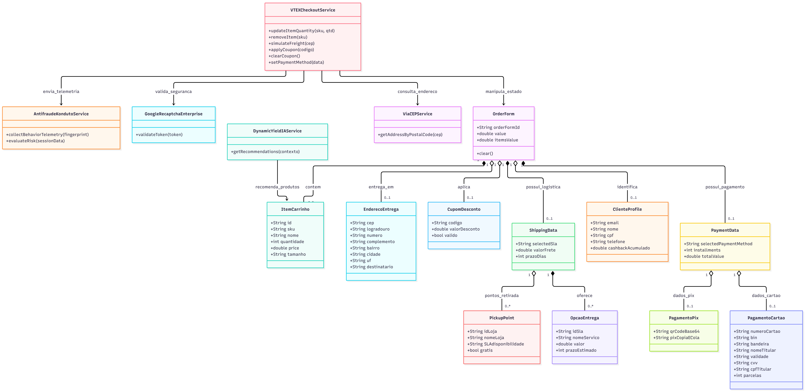
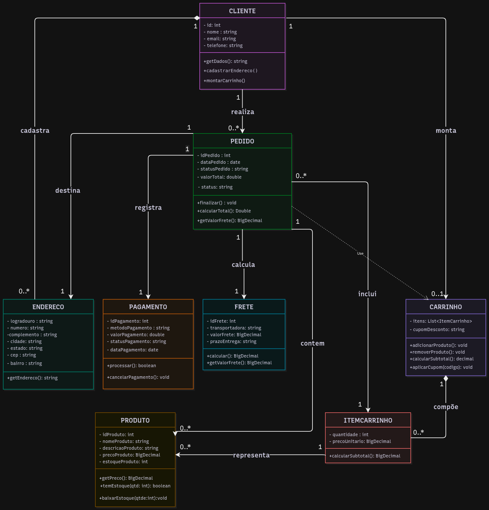
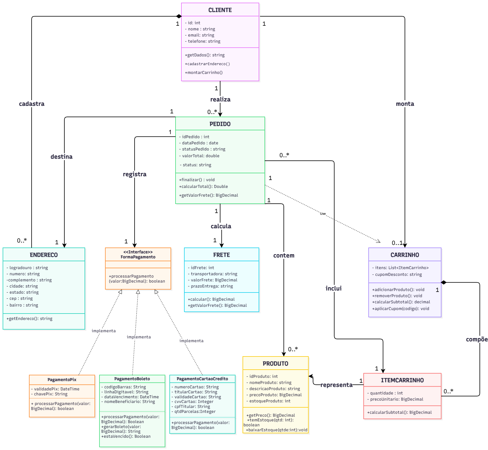

## Mapeamento do Fluxo

Com base na análise empírica de engenharia reversa realizada e documentada no relatório de inspeção do fluxo C, foi feito o mapeamento de arquitetura do sistema que compõe o fluxo analisado: Carrinho -> Checkout -> Pagamento. 

O sistema real opera sob uma arquitetura orientada a serviços e microsserviços (plataforma VTEX), na qual o front-end se comunica assincronamente com múltiplos serviços especialistas de back-end e provedores terceiros. 

O modelo completo do sistema engloba três camadas principais de responsabilidade: 

* **Camada de Apresentação e Gestão de Estado (Front-End):** Responsável pela interface do usuário e manutenção do estado da sessão durante a navegação sem exigir recarregamentos completos da página.
* **Camada de Negócio e Serviços Core (Plataforma VTEX):** Conjunto de microsserviços do e-commerce responsáveis pela lógica de negócio e persistência das etapas da compra (serviços de catálogo, disponibilidade de estoque, carrinho, pedido, logística, entre outros).
* **Camada de Serviços Transversais e Integrações Terceiras:** Serviços que atuam de forma paralela ao fluxo principal para enriquecer a experiência, garantir a segurança financeira e coletar dados operacionais (motor de recomendações, IA, camadas de segurança, antifraude, risco, monitoramento).

  <b>Figura 1:</b> Diagrama de Classes do Fluxo C. Fonte: Confeccionado por IA.

 

O diagrama acima tem como objetivo ilustrar visualmente a modelagem do sistema, servindo de apoio para reduzir a abstração da arquitetura mapeada. Ele sintetiza as principais classes e interações estruturais do escopo:

- **Serviço Principal / Controlador (`VTEXCheckoutService`):** Atua no topo do fluxo gerenciando as ações globais e orquestrando as chamadas de serviços e atualização de estado.
- **Classes de Domínio e Estado (`OrderForm` e agregados):** Centraliza os dados da sessão/pedido, agregando estruturas como `ItemCarrinho`, `EnderecoEntrega`, `CupomDesconto`, `ShippingData`, `ClienteProfile` e `PaymentData`.
- **Classes de Serviços e Integrações (`ViaCEPService`, `DynamicYieldService`, `GoogleRecaptchaEnterprise`, `AntifraudeKondutoService`):** Fazem a ponte com APIs de consulta de endereço (CEP), personalização/IA, segurança (reCAPTCHA) e análise antifraude.

---

## Abstração e Simplificação do Modelo

A análise realizada revelou um ecossistema real de alta complexidade, caracterizado por desacoplamento de microsserviços, telemetria comportamental em tempo real (antifraude), motores de recomendação alimentados por IA e monitoramento de desempenho (analytics e logging).  

No contexto do desenvolvimento de arquitetura de software acadêmica, optou-se por simplificar o modelo do sistema analisado, justificada pela redução da complexidade do sistema e pela independência dos padrões comportamentais em relação ao modelo completo, assegurando que o desenvolvimento do projeto se concentre nos pontos de variação e na lógica de interação entre as classes do domínio.  

#### Remoção de elementos fora do escopo
Para a construção do modelo simplificado, os seguintes componentes mapeados no relatório de inspeção foram intencionalmente desconsiderados:  

* **Serviços Transversais de IA e Recomendação (`DynamicYieldAdapter`):** Removidos por tratarem de personalização de vitrines e UX, sem impacto na regra de negócio core do checkout. 
* **Camada de Antifraude e Telemetria (`KondutoAntiFraude`, `ReCaptchaValidator`):** Removida por ser um serviço de segurança de infraestrutura delegado a terceiros. 
* **Sistemas de Monitoramento e Analytics (`GA4Tracker`, `SentryLogger`, `AmplitudeAnalytics`):** Removidos por não pertencerem à lógica do domínio da aplicação. 
* **Gerenciadores de Estado HTTP e Sincronização de APIs (`OrderForm`, `ViaCEPService`):** Substituídos por abstrações diretas de objetos em memória. 

---

## Modelagem do Sistema
O diagrama a seguir ilustra o escopo modelado do sistema, estruturado especificamente para a aplicação e validação dos padrões comportamentais propostos. 

  <b>Figura 2:</b> Modelo 1 - Diagrama de Classes do Fluxo C sem padrão de projeto. Fonte: Confeccionado por Letícia e Rafaela.

 

 

<b> Histórico de Versionamento e Evolução do Diagrama (Clique para expandir)</b>

 

| Versão | Data | Modificações Realizadas |
| :--- | :--- | :--- |
| **v0.1** | 12/10/2026 | Modelagem inicial diagramada por Letícia |
| **v0.2** | 13/10/2026 | Correções do modelo proposto: relacionamentos e atributos; Melhora do layout, por Rafaela |
| **v1.0** | 14/10/2026 | Correção do relacionamento Pedido - Carrinho, por Letícia |

> **Nota de Versionamento:** O diagrama completo e interativo pode ser acessado online [aqui](https://drive.google.com/file/d/1xnPNZh4ZvVBz5o62hEkzHH94r93ELc3M/view?usp=sharing).

#### Dicionário de Classes
| Classe | Papel Principal no Domínio |
| :--- | :--- |
| **Carrinho** | Contêiner central da sessão de compras; gerencia itens, cálculos de subtotal e regras de frete grátis. |
| **ItemCarrinho** | Elemento intermediário que conecta o Carrinho a um Produto específico, controlando quantidade e subtotal. |
| **Produto** | Entidade de catálogo que armazena dados essenciais (SKU, título, preço e variações). |
| **Cliente** | Agrupa dados cadastrais e de identificação do usuário coletados no perfil. |
| **Endereço** | Agrupa as informações de entrega e geolocalização validadas pelo serviço de autocompletar. |
| **Frete** | Encapsula a modalidade de entrega escolhida (Econômica, Expressa, etc.) e o respectivo custo. |
| **Pagamento** | Centraliza a transação financeira (Cartão, PIX, etc.), integrando adquirentes e antifraude. |
| **Pedido** | Entidade agregadora central que consolida carrinho, cliente, frete e pagamento para fechamento (`orderForm`). |

#### Análise de Métodos e Semântica
| Classe | Métodos Declarados | Avaliação Técnica & Ajustes Recomendados |
| :--- | :--- | :--- |
| **Cliente** | `+getDados(): String` | Adequado para o escopo simplificado. Avaliar se futuramente precisará de `atualizarCadastro()`. |
| **Endereço** | `+getEndereço(): String` | Atende à formatação. **Atenção:** Evitar caracteres especiais (`ç`) no nome do método para prevenir erros de compilação. |
| **Pagamento** | `+processar(): boolean` `+cancelarPagamento(): void` | Perfeitos. Alinhados diretamente com o padrão *Strategy* para alternância de meios de pagamento. |
| **Frete** | `+calcular(): BigDecimal` | Correto. Reflete a lógica de simulação logística e serve de ponto de variação para o *Strategy*. |
| **Pedido** | `+finalizar(): void` `+calcularTotal(): Double` | **Ajustes:** Corrigir a sintaxe de `+calcularTotal(): Double`. **Sugestão:** Adicionar método de transição de estado (`mudarEstado()`) para suportar o padrão *State*. |
| **Carrinho** | `+adicionarProduto(): void` `+removerProduto(): void` `+calcularSubtotal(): Decimal` `+aplicarCupom(codigo): void` | Completos. **Ajuste:** Padronizar o tipo de retorno de `Decimal` para `BigDecimal`. |
| **ItemCarrinho** | `+calcularSubtotal(): BigDecimal` | Correto. Multiplica a quantidade pelo preço unitário do item. |
| **Produto** | `+getPreco(): BigDecimal` | Adequado para exposição do preço unitário base. |

#### Mapeamento de Relacionamentos
| Relação | Tipo / Multiplicidade | Análise Semântica |
| :--- | :--- | :--- |
| **Cliente ↔ Pedido** | `(1) ──── (0..*)` *realiza / originado de* | Um cliente pode realizar múltiplos pedidos ao longo do tempo; todo pedido pertence obrigatoriamente a um único cliente. |
| **Cliente ↔ Endereço** | `(1) ──── (0..*)` *possui* | Um cliente pode salvar múltiplos endereços de entrega em seu perfil. |
| **Pedido ↔ Endereço** | `(1) ──── (1)` *entrega em* | Cada pedido finalizado vincula-se estritamente a um endereço de entrega. |
| **Pedido ↔ Pagamento** | `(1) ──── (1)` *possui* | Cada pedido fechado está associado a uma única transação de pagamento correspondente. |
| **Pedido ↔ Frete** | `(1) ──── (1)` *possui* | O pedido consolida a modalidade e o custo logístico escolhidos pelo usuário. |
| **Pedido ↔ Carrinho** | `(0..1) ──── (1)` *utiliza* | O pedido consome os dados de um carrinho ativo (que pode ser esvaziado após a finalização). |
| **Carrinho ↔ ItemCarrinho** | `(1) ──── (0..*)` *contém* | Um carrinho agrupa vários itens selecionados (ou nenhum, se estiver vazio). |
| **ItemCarrinho ↔ Produto** | `(*) ──── (1)` *referencia* | Vários itens de carrinho podem apontar para o mesmo produto do catálogo (variando apenas as quantidades). |

## Pontos de Variação e Aplicação de Padrões GoF
Para atender aos requisitos de flexibilidade e extensibilidade do fluxo de transações no e-commerce, adotou-se a aplicação do padrão de projeto comportamental *Strategy* no módulo de pagamento, justificada pela necessidade de suportar diferentes modalidades de liquidação financeira (como Cartão de Crédito com regras de parcelamento via BIN e PIX com geração dinâmica de QR Code) de forma totalmente desacoplada da entidade central do pedido. 

Sem a aplicação de um padrão de projeto, a classe responsável pelo pagamento tenderia a acumular estruturas condicionais complexas (como múltiplos blocos `if/else` ou `switch/case`) para tratar as regras específicas de cada adquirente ou forma de submissão. Isso violaria o princípio aberto/fechado (*Open/Closed Principle - OCP*), tornando o sistema rígido a manutenções e propenso a falhas na inclusão de novos meios de pagamento (como carteiras digitais ou boletos).  

O padrão *Strategy* resolve essa problemática ao encapsular cada família de algoritmos em classes independentes, permitindo que eles sejam trocados em tempo de execução sem impactar o cliente (GAMMA et al., 1994).

---

## Padrão *Strategy*
Com o objetivo de alcançar alta coesão e baixo acoplamento — permitindo que novas formas de pagamento sejam integradas à arquitetura de forma modular —, a modelagem do sistema foi estruturada sob os pilares fundamentais do padrão *Strategy*, conforme formalizado na literatura de padrões de projeto (GAMMA et al., 1994): 

* **Interface Estratégia (`FormaPagamento`):** Define o contrato comportamental comum que todas as modalidades de pagamento devem implementar, estipulando o método central de execução da transação (`processarPagamento()`).
* **Estratégias Concretas (`PagamentoPix`, `PagamentoCartaoCredito`, `PagamentoBoleto`):** Implementam as regras de negócio particulares e os atributos específicos exigidos por每个 modalidade financeira, isolando as complexidades de validação em classes independentes.
* **Contexto (`Pedido`):** Mantém uma referência polimórfica para a estratégia ativa escolhida pelo cliente durante o *checkout*, delegando a execução da transação para o objeto concreto correspondente sem que a classe conheça os detalhes internos de cada meio de pagamento.

  <b>Figura 3:</b> Modelo 2 - Diagrama de Classes do Fluxo C com padrão de projeto. Fonte: Confeccionado por Letícia e Rafaela.

 

 

<b> Histórico de Versionamento e Evolução do Diagrama (Clique para expandir)</b>

 

| Versão | Data | Modificações Realizadas |
| :--- | :--- | :--- |
| **v0.1** | 12/10/2026 | Modelagem inicial com aplicação do Padrão GoF *Strategy* |
| **v1.0** | 14/10/2026 | Altera o modelo inicial usando o Modelo 1. Confeccionado por Letícia, revisado e aprovado por Rafaela |

> **Nota de Versionamento:** O diagrama completo e interativo pode ser acessado online [aqui](https://drive.google.com/file/d/1PAof5HkGvJISSdFrAPxbfek8Zh8LF6Cr/view?usp=sharing).

### Detalhamento das Modificações do Padrão Strategy

#### 1. Modificações em Classes

* **Introdução da Interface `<<Interface>> FormaPagamento`:** Foi criada uma nova abstração para servir de contrato central do padrão *Strategy*, definindo o comportamento comum que todas as modalidades de pagamento devem seguir.
* **Criação de Classes Concretas de Pagamento:** A antiga classe genérica Pagamento foi desmembrada em três classes especializadas que herdam/implementam a interface FormaPagamento:
  * **PagamentoPix**
  * **PagamentoCartaoCredito**
  * **PagamentoBoleto**
* **Remoção da classe genérica antiga:** A classe isolada de pagamento monolítica foi substituída pelas estratégias concretas, eliminando a necessidade de estruturas condicionais (`if/else`) no código.

#### 2. Modificações em Atributos

* **Na classe Pedido:**
  * Foi adicionado o atributo **- formaPagamento: FormaPagamento**. É por meio dele que o pedido passa a referenciar de forma polimórfica a estratégia de pagamento escolhida pelo cliente em tempo de execução.
* **Nas Classes Concretas (PagamentoPix, PagamentoCartaoCredito, PagamentoBoleto):**
  * Cada classe agora possui exclusivamente os atributos específicos do seu domínio financeiro:
    * **PagamentoPix:** `- validePix: DateTime`, `- chavePix: String`.
    * **PagamentoCartaoCredito:** `- numeroCartao: String`, `- titularCartao: String`, `- validadeCartao: String`, `- cvvCartao: Integer`, `- cpfTitular: String`, `- qtdParcelas: Integer`.
    * **PagamentoBoleto:** `- codigoBarras: String`, `- linhaDigitavel: String`, `- dataVencimento: DateTime`, `- nomeBeneficiario: String`.

#### 3. Modificações em Métodos

* **Na interface FormaPagamento:**
  * Declaração do método padrão da estratégia: `+processarPagamento(valor: BigDecimal): boolean`.
* **Na classe Pedido:**
  * Adição do método de associação/inversão de controle: `+setFormaPagamento(forma: FormaPagamento): void`, permitindo injetar a estratégia escolhida no pedido.
* **Nas Classes Concretas:**
  * **PagamentoPix** e **PagamentoCartaoCredito** implementam o método `+processarPagamento(valor: BigDecimal): boolean`.
  * **PagamentoBoleto** implementa operações adicionais pertinentes ao seu ciclo específico: `+processarPagamento(valor: BigDecimal): Boolean`, `+gerarBoleto(valor: BigDecimal): String` e `+estaVencido(): Boolean`.

#### 4. Modificações em Ligações e Relacionamentos

* **Associação Pedido ──── FormaPagamento:** O Pedido agora se conecta diretamente à interface FormaPagamento (com multiplicidade 1 para 1), permitindo que a transação ocorra de maneira genérica sem acoplamento rígido.
* **Relações de Realização/Implementação (Setas tracejadas com ponta vazia):** As classes **PagamentoPix**, **PagamentoCartaoCredito** e **PagamentoBoleto** apontam para a interface FormaPagamento, indicando que cumprem aquele contrato arquitetural.

---

#### Referências Bibliográficas

**GAMMA, Erich et al.** *Design Patterns: Elements of Reusable Object-Oriented Software*. Boston: Addison-Wesley, 1994.

---

> **Histórico de Versões**
> 
> | Versão | Data | Descrição | Autores |
> | :---: | :---: | :--- | :--- |
> | `0.1` | 14/10/2026 | Criação e Estruturação da página | [Rafaela Andrea](https://github.com/radamesGuerra) |
> | `0.2` | 15/10/2026 | Acrescenta o texto referente à modelagem inicial e parte da aplicação do Padrão *Strategy* | [Leticia Santos](https://github.com/LeticiaSantosss) |
> | `0.3` | 16/10/2026 | Acrescenta o texto referente à aplicação do Padrão *Strategy* e adiciona os versionamentos e links de referencias aos diagramas elaboraborados pelas autoras | [Rafaela Andrea](https://github.com/radamesGuerra) |