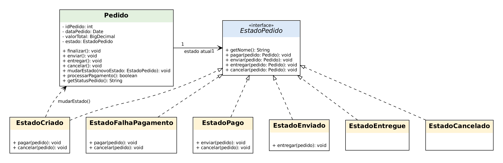
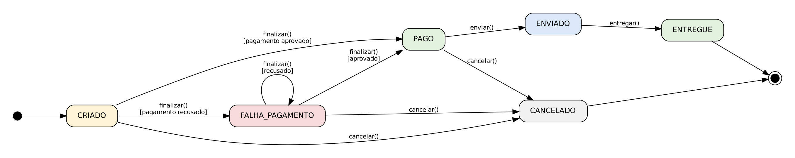
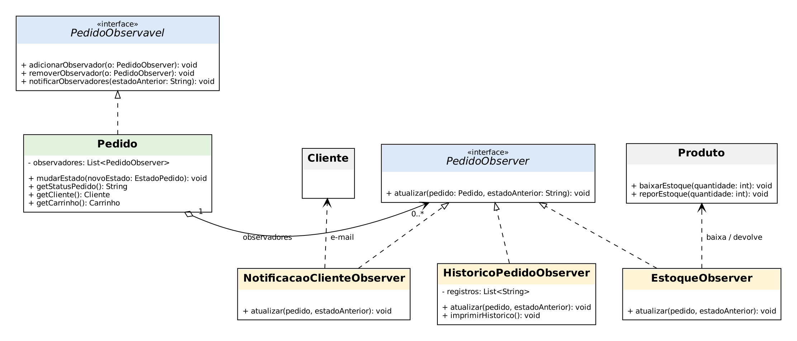

# Padrões State e Observer — Ciclo de Vida do Pedido

## 1. Introdução

Esta página documenta a aplicação de mais dois padrões GoF comportamentais, **State** e **Observer**, ao Fluxo C (Carrinho, Checkout e Pagamentos). Eles complementam o [Strategy](/Base/Relatorios/1.1.3.subequipe-03/padroesprojetoEquipe03.md) já aplicado ao pagamento e usam como base o mesmo modelo simplificado da Subequipe 03, em que a classe `Pedido` é a entidade central.

| Padrão | Problema do Fluxo C que resolve | Papel do `Pedido` |
| :--- | :--- | :--- |
| **State** | O pedido passa por etapas (criado, pago, enviado, entregue, cancelado) e cada etapa permite operações diferentes. | Contexto |
| **Observer** | Quando o pedido muda de etapa, outras partes do sistema precisam reagir (avisar o cliente, ajustar estoque, registrar histórico) sem que o `Pedido` as conheça. | Subject (observável) |

---

## 2. Rastreabilidade com o estudo base

As decisões partem do [Relatório de Inspeção do Fluxo C](/Base/Relatorios/1.1.3.subequipe-03/RelatorioInspecaoFluxoC.pdf) e da modelagem da Subequipe 03:

- **Estado do pedido (State).** A inspeção conclui que a plataforma mantém a persistência e a sincronização contínua do estado do pedido pelo objeto `orderForm` (seção 5, Considerações Finais). Na seção 4.5, a troca da forma de pagamento atualiza esse estado via `paymentData`. A modelagem da Subequipe 03 já sugeria, na análise de métodos da classe `Pedido`, "adicionar método de transição de estado (`mudarEstado()`) para suportar o padrão *State*".
- **Reação a mudanças (Observer).** A seção 4.2 descreve a "alta reatividade" do checkout: alterar a quantidade de um item dispara recálculo de frete e total. Nas seções 4.3 e 4.5, eventos de interação e falhas são enviados a serviços de analytics e telemetria. Em ambos os casos, uma mudança em um ponto aciona vários consumidores independentes, que é o problema que o Observer resolve.
- **Código já existente.** O `Produto` já tinha `baixarEstoque()` com o comentário "a ser chamada ao finalizar o pedido", e o `Pedido` já guardava o status como texto (`CRIADO`, `PAGO`, `FALHA_PAGAMENTO`). Esses pontos eram, na prática, o gancho para os dois padrões.

No escopo simplificado, os serviços de terceiros (antifraude, analytics, recomendação) foram deliberadamente removidos do modelo. Os observadores implementados são, portanto, versões locais e simuladas: notificação ao cliente, controle de estoque e histórico de auditoria.

---

## 3. Modelagem

### 3.1. Padrão State

O `Pedido` deixa de guardar o status como `String` e passa a referenciar um objeto `EstadoPedido`. Cada estado concreto decide quais operações aceita e para qual estado o pedido vai em seguida.

- **Context:** `Pedido`, que delega `finalizar()`, `enviar()`, `entregar()` e `cancelar()` ao estado atual e expõe `mudarEstado()`.
- **State:** interface `EstadoPedido`.
- **ConcreteStates:** `EstadoCriado`, `EstadoFalhaPagamento`, `EstadoPago`, `EstadoEnviado`, `EstadoEntregue` e `EstadoCancelado`.


<div align="center">
  <sub><b>Figura 1:</b> Diagrama de classes do padrão State aplicado ao Pedido. Fonte: elaborado a partir do código-fonte.</sub>
</div>
<br>

As transições permitidas são mostradas na máquina de estados abaixo. Qualquer operação que não aparece como seta a partir do estado atual é rejeitada com `IllegalStateException`.


<div align="center">
  <sub><b>Figura 2:</b> Máquina de estados do Pedido. Fonte: elaborado a partir do código-fonte.</sub>
</div>
<br>

| Estado | `finalizar()` (pagar) | `enviar()` | `entregar()` | `cancelar()` |
| :--- | :---: | :---: | :---: | :---: |
| `CRIADO` | permitido (vai a `PAGO` ou `FALHA_PAGAMENTO`) | bloqueado | bloqueado | permitido |
| `FALHA_PAGAMENTO` | permitido (nova tentativa) | bloqueado | bloqueado | permitido |
| `PAGO` | bloqueado | permitido | bloqueado | permitido |
| `ENVIADO` | bloqueado | bloqueado | permitido | bloqueado |
| `ENTREGUE` | bloqueado | bloqueado | bloqueado | bloqueado |
| `CANCELADO` | bloqueado | bloqueado | bloqueado | bloqueado |

### 3.2. Padrão Observer

O `Pedido` mantém uma lista de observadores e os avisa sempre que `mudarEstado()` é chamado. Cada observador cuida de uma responsabilidade própria.

- **Subject:** interface `PedidoObservavel`, implementada por `Pedido`.
- **Observer:** interface `PedidoObserver`, com o método `atualizar(pedido, estadoAnterior)`.
- **ConcreteObservers:** `NotificacaoClienteObserver`, `EstoqueObserver` e `HistoricoPedidoObserver`.

Foi usada a variante *pull*: o observador recebe o pedido e consulta o que precisa (por exemplo, o novo estado e o carrinho), em vez de receber todos os dados na chamada. Os observadores consultam o `Pedido`; essa seta de dependência foi omitida do diagrama para não poluí-lo.


<div align="center">
  <sub><b>Figura 3:</b> Diagrama de classes do padrão Observer aplicado ao Pedido. Fonte: elaborado a partir do código-fonte.</sub>
</div>
<br>

| Observador | Reage a | O que faz |
| :--- | :--- | :--- |
| `NotificacaoClienteObserver` | qualquer mudança de estado | Simula o envio de e-mail ao cliente com uma mensagem específica para cada estado. |
| `EstoqueObserver` | `PAGO` e `CANCELADO` (vindo de `PAGO`) | Dá baixa no estoque dos produtos do carrinho; devolve se o pedido pago for cancelado. |
| `HistoricoPedidoObserver` | qualquer mudança de estado | Guarda cada transição com horário, formando o histórico do pedido. |

> **Nota de versionamento:** os diagramas foram gerados com Graphviz a partir de arquivos-fonte versionados em [`docs/assets/documents/diagramas-state-observer`](https://github.com/UnBArqDsw2026-2-Turma02/2026.2-T02-_G1_ProjetoComercioEletr-nico_Entrega_03/tree/main/docs/assets/documents/diagramas-state-observer), para que possam ser editados e regerados.

### 3.3. Como os três padrões convivem

O `Pedido` participa dos três padrões ao mesmo tempo, sem que eles se misturem:

1. **Strategy** decide *como* cobrar: `FormaPagamento` (Pix, cartão ou boleto).
2. **State** decide *se* o pedido pode ser cobrado, enviado, entregue ou cancelado naquele momento.
3. **Observer** decide *quem é avisado* depois que o estado muda.

Na prática, `EstadoCriado.pagar()` chama `pedido.processarPagamento()`, que usa a estratégia de pagamento atual; conforme o resultado, o estado chama `pedido.mudarEstado(...)`, e os observadores são notificados.

---

## 4. Implementação

Código em Java, no mesmo pacote `subequipe03.ecommerce` do Strategy:

| Papel | Arquivos |
| :--- | :--- |
| State (interface) | [`EstadoPedido.java`](https://github.com/UnBArqDsw2026-2-Turma02/2026.2-T02-_G1_ProjetoComercioEletr-nico_Entrega_03/blob/main/src/subequipe03/ecommerce/EstadoPedido.java) |
| State (concretos) | `EstadoCriado.java`, `EstadoFalhaPagamento.java`, `EstadoPago.java`, `EstadoEnviado.java`, `EstadoEntregue.java`, `EstadoCancelado.java` |
| Observer (interfaces) | `PedidoObservavel.java`, `PedidoObserver.java` |
| Observer (concretos) | `NotificacaoClienteObserver.java`, `EstoqueObserver.java`, `HistoricoPedidoObserver.java` |
| Contexto / Subject | [`Pedido.java`](https://github.com/UnBArqDsw2026-2-Turma02/2026.2-T02-_G1_ProjetoComercioEletr-nico_Entrega_03/blob/main/src/subequipe03/ecommerce/Pedido.java) (alterado) |
| Demonstração | [`MainStateObserver.java`](https://github.com/UnBArqDsw2026-2-Turma02/2026.2-T02-_G1_ProjetoComercioEletr-nico_Entrega_03/blob/main/src/subequipe03/ecommerce/MainStateObserver.java) |

### Alterações em classes existentes

- **`Pedido`:** o atributo `statusPedido: String` foi substituído por `estado: EstadoPedido`. `finalizar()` agora delega ao estado, e `getStatusPedido()` continua devolvendo o nome do estado, então os usos anteriores seguem válidos. Foram adicionados `enviar()`, `entregar()`, `cancelar()`, `mudarEstado()`, `processarPagamento()`, o registro de observadores e os getters `getCliente()`, `getCarrinho()` e `getFormaPagamento()`.
- **`Produto`:** novo método `reporEstoque(int)`, usado na devolução ao estoque após o cancelamento de um pedido pago.
- **`Main` (interativa do Strategy):** não foi alterada e continua funcionando com o mesmo comportamento.

### Trechos principais

O estado decide a transição e o `Pedido` apenas a executa:

```java
// EstadoCriado.java
@Override
public void pagar(Pedido pedido) {
    boolean pago = pedido.processarPagamento();
    if (pago) {
        System.out.println("Pedido #" + pedido.getIdPedido()
                + " finalizado com sucesso! Total: R$ " + pedido.getValorTotal());
        pedido.mudarEstado(new EstadoPago());
    } else {
        System.out.println("Falha ao processar o pagamento do pedido #" + pedido.getIdPedido());
        pedido.mudarEstado(new EstadoFalhaPagamento());
    }
}
```

A troca de estado dispara a notificação, e uma falha em um observador não impede os demais:

```java
// Pedido.java
public void mudarEstado(EstadoPedido novoEstado) {
    String estadoAnterior = this.estado.getNome();
    this.estado = novoEstado;
    notificarObservadores(estadoAnterior);
}

@Override
public void notificarObservadores(String estadoAnterior) {
    for (PedidoObserver observador : new ArrayList<>(observadores)) {
        try {
            observador.atualizar(this, estadoAnterior);
        } catch (RuntimeException e) {
            System.out.println("   [Aviso] " + observador.getClass().getSimpleName()
                    + " falhou: " + e.getMessage());
        }
    }
}
```

---

## 5. Execução

Requisito: JDK 17 ou superior (testado com JDK 17 e 21). A partir da raiz do repositório:

```bash
javac -encoding UTF-8 -d out src/subequipe03/ecommerce/*.java
java -cp out subequipe03.ecommerce.MainStateObserver
```

A demonstração não pede digitação e percorre cinco cenários:

| Cenário | O que demonstra |
| :--- | :--- |
| 1. Fluxo completo | `CRIADO` → `PAGO` → `ENVIADO` → `ENTREGUE`, com os três observadores reagindo e o histórico impresso no final. |
| 2. Pagamento recusado | `CRIADO` → `FALHA_PAGAMENTO`; troca da estratégia para Pix e nova tentativa, chegando a `PAGO`. Mostra State e Strategy trabalhando juntos. |
| 3. Transições inválidas | Enviar sem pagar, pagar duas vezes, cancelar após o envio e enviar após a entrega são bloqueados pelo State. |
| 4. Cancelamento após pagamento | O `EstoqueObserver` devolve os itens ao estoque (5 → 2 → 5). |
| 5. Remoção de observador | Depois de `removerObservador()`, o cliente deixa de receber e-mails, mas o histórico continua registrando. |

Trecho da saída do cenário 1:

```text
> pedido.finalizar()
Processando Pix no valor de R$ 300.00 com a chave camile@exemplo.com
Pedido #1001 finalizado com sucesso! Total: R$ 300.00
   [E-mail para camile@exemplo.com] Pedido #1001: pagamento confirmado.
   [Estoque] Baixa de 2x Teclado Mecânico (restam 8).

> pedido.enviar()
   [E-mail para camile@exemplo.com] Pedido #1001: seu pedido saiu para entrega.
```
**Vídeo da execução:**

<div align="center">
  <video controls width="720" src="../../../assets/images/execucao-state-observer-camile.mp4"></video>
</div>

## 6. Senso crítico e limitações

- **Modificação de classe existente.** O State exigiu alterar o `Pedido`, que é compartilhado com o Strategy. A alteração foi feita preservando a interface pública usada antes (`finalizar()`, `getStatusPedido()`) e verificada executando a `Main` interativa original.
- **Observadores comparam o estado por texto.** `EstoqueObserver` e `NotificacaoClienteObserver` identificam o estado pelo nome (`"PAGO"`, `"CANCELADO"`). Funciona, mas é frágil a erros de digitação; uma evolução seria usar um `enum` ou um método como `estado.isPago()`.
- **Notificação síncrona.** Os observadores rodam na mesma thread da mudança de estado. Em um sistema real, e-mail e analytics seriam assíncronos (fila de mensagens), como observado nas chamadas assíncronas do relatório de inspeção.
- **Falha de observador não desfaz a mudança.** Se o `EstoqueObserver` falhar por estoque insuficiente, o pedido continua `PAGO` e apenas um aviso é impresso (comportamento testado). Isso evita que uma falha de notificação bloqueie o fluxo, mas deixa uma inconsistência: o ideal seria validar o estoque *antes* de cobrar, o que ficou fora do escopo.
- **Estados sem dados próprios.** Os estados não guardam informação, então poderiam ser instâncias únicas compartilhadas em vez de `new` a cada transição. Optou-se pela forma mais simples e legível.
- **Métodos padrão na interface.** `EstadoPedido` usa métodos `default` que rejeitam a operação, para que cada estado concreto declare apenas o que aceita. A alternativa clássica seria uma classe abstrata; a interface foi mantida por coerência com `FormaPagamento`.
- **Escopo do Observer.** Os observadores são simulados (sem e-mail real, sem banco). O objetivo é demonstrar a estrutura e o desacoplamento, não a integração com serviços externos.

---

## 7. Apoio de IA generativa

Esta etapa foi desenvolvida com apoio de IA generativa (Claude), usada para propor a estrutura das classes, gerar o código-fonte e os diagramas e redigir o rascunho desta página. O código foi compilado, executado e conferido contra os diagramas. O ponto de vista individual da autora sobre o uso da IA deve constar em [IA Generativa e Lições Aprendidas](/Base/Relatorios/1.1.3.subequipe-03/iaEquipe03.md).

---

## Referências Bibliográficas

1. **GAMMA, Erich et al.** *Design Patterns: Elements of Reusable Object-Oriented Software*. Boston: Addison-Wesley, 1994. (Observer, p. 293; State, p. 305.)
2. **FOWLER, Martin.** *UML Distilled: A Brief Guide to the Standard Object Modeling Language*. 3ª ed. Addison-Wesley, 2003. (Diagramas de classes e de máquina de estados.)
3. **Relatório de Inspeção do Fluxo C** — [RelatorioInspecaoFluxoC.pdf](/Base/Relatorios/1.1.3.subequipe-03/RelatorioInspecaoFluxoC.pdf).
4. [Modelagem e padrão Strategy da Subequipe 03](/Base/Relatorios/1.1.3.subequipe-03/padroesprojetoEquipe03.md).

---
> **Histórico de Versões**
>
> | Versão | Data | Descrição | Autores |
> | :---: | :---: | :--- | :--- |
> | `0.1` | 19/10/2026 | Criação da página: modelagem, implementação e execução dos padrões State e Observer | [Camile Barbosa](https://github.com/Camile0318) |
