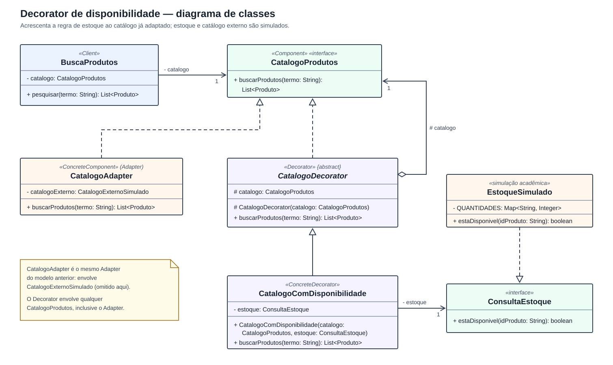

# GoF Estrutural — Decorator de Disponibilidade

## Divisão de Responsabilidades

| Etapa / Tópico do Relatório | Autor(a) Principal | Evidência / Commit |
| --- | --- | --- |
| Problema, escolha do Decorator, modelagem UML, código Java, testes e documentação | [Nayra Silva Nery](https://github.com/NayraNery127) | [Commits da branch `feat/decorator-disponibilidade`](https://github.com/UnBArqDsw2026-2-Turma02/2026.2-T02-_G1_ProjetoComercioEletr-nico_Entrega_03/commits/feat/decorator-disponibilidade) |

## 1. Contexto e problema

O [Adapter da Subequipe 02](/Base/Relatorios/subequipe02/gof_estrutural.md) resolveu a incompatibilidade entre a busca e o catálogo externo simulado. O seu recorte, porém, terminava na obtenção dos resultados: a **validação de estoque**, que aparece no diagrama de sequência da Entrega 02, foi declarada fora do exemplo. Assim, a busca exibia todos os produtos encontrados, inclusive os que não poderiam ser comprados.

Esta entrega acrescenta a regra **"mostrar somente produtos disponíveis"**. A dificuldade de projeto é decidir **onde** essa regra deve ficar:

| Alternativa | Problema |
| --- | --- |
| Colocar o filtro dentro de `CatalogoAdapter` | Mistura duas responsabilidades: traduzir o fornecedor e aplicar regra de negócio. O Adapter deixaria de ser reutilizável quando a regra não for desejada. |
| Colocar o filtro dentro de `BuscaProdutos` | O cliente passaria a conhecer o estoque, aumentando seu acoplamento. |
| Criar uma subclasse de `CatalogoAdapter` | A regra ficaria presa a um único catálogo; outro catálogo exigiria outra subclasse, e cada nova regra multiplicaria as subclasses. |

Como no Adapter, os dados de estoque são uma **simulação acadêmica**: não se afirma que representem o sistema real da loja estudada.

## 2. Escolha do padrão

O **Decorator** é um padrão GoF estrutural que acrescenta responsabilidades a um objeto **dinamicamente**, oferecendo uma alternativa flexível à herança para estender funcionalidades (GAMMA et al., 1994). O decorador implementa a mesma interface do objeto que envolve, repassa a chamada a ele e acrescenta o seu próprio comportamento antes ou depois.

Nesta solução, `CatalogoComDisponibilidade` implementa `CatalogoProdutos`, envolve qualquer catálogo que siga esse contrato (no exemplo, o `CatalogoAdapter`) e remove do resultado os produtos sem estoque. Para `BuscaProdutos`, nada muda: continua recebendo um `CatalogoProdutos`.

| Papel no padrão | Elemento | Responsabilidade |
| --- | --- | --- |
| **Component** | `CatalogoProdutos` | Contrato comum: `buscarProdutos(termo)`. |
| **ConcreteComponent** | `CatalogoAdapter` | Catálogo real que será decorado (é o Adapter já existente). |
| **Decorator** | `CatalogoDecorator` (abstrato) | Guarda uma referência a um `CatalogoProdutos` e repassa a chamada a ele. |
| **ConcreteDecorator** | `CatalogoComDisponibilidade` | Acrescenta o filtro de disponibilidade ao resultado. |
| Colaborador | `ConsultaEstoque` / `EstoqueSimulado` | Informar se um produto está disponível. |
| **Client** | `BuscaProdutos` | Usa o catálogo sem saber se ele está decorado. |

**Adapter e Decorator lado a lado:** os dois envolvem outro objeto, mas com intenções diferentes. O Adapter **muda a interface** (de `consultarItens` para `buscarProdutos`). O Decorator **mantém a interface** e **acrescenta comportamento**. Por isso o Decorator pode envolver o Adapter sem que nenhum dos dois seja alterado.

## 3. Modelagem UML



*Figura 1 — Diagrama de classes do Decorator. Atributos privados (`-`), protegidos (`#`) e públicos (`+`). `CatalogoExternoSimulado`, `ItemExterno` e `Produto` foram omitidos por já constarem na [modelagem do Adapter](/Base/Relatorios/subequipe02/modelagem.md).*

Relações representadas:

1. `CatalogoAdapter` e `CatalogoDecorator` **realizam** `CatalogoProdutos` (linha tracejada com triângulo vazio).
2. `CatalogoDecorator` mantém uma **agregação** com **um** `CatalogoProdutos` (losango vazio): recebe no construtor um catálogo já criado, sem controlar seu ciclo de vida. É essa referência que permite empilhar decoradores.
3. `CatalogoComDisponibilidade` **especializa** `CatalogoDecorator` (linha contínua com triângulo vazio) e se associa a **uma** `ConsultaEstoque`.
4. `EstoqueSimulado` **realiza** `ConsultaEstoque`.

Fluxo da chamada: `BuscaProdutos` → `CatalogoComDisponibilidade.buscarProdutos(termo)` → `CatalogoAdapter.buscarProdutos(termo)` → catálogo simulado. O resultado volta pelo mesmo caminho e, na saída do Decorator, os produtos indisponíveis são removidos.

## 4. Implementação

O código está em [`src/subequipe02`](https://github.com/UnBArqDsw2026-2-Turma02/2026.2-T02-_G1_ProjetoComercioEletr-nico_Entrega_03/tree/main/src/subequipe02) e segue o mesmo pacote do Adapter.

**Decorator abstrato** — implementa o contrato e apenas repassa a chamada:

```java
public abstract class CatalogoDecorator implements CatalogoProdutos {
    protected final CatalogoProdutos catalogo;

    protected CatalogoDecorator(CatalogoProdutos catalogo) {
        this.catalogo = Objects.requireNonNull(catalogo, "catalogo");
    }

    @Override
    public List<Produto> buscarProdutos(String termo) {
        return catalogo.buscarProdutos(termo);
    }
}
```

**Decorator concreto** — chama o catálogo envolvido e acrescenta o filtro:

```java
public final class CatalogoComDisponibilidade extends CatalogoDecorator {
    private final ConsultaEstoque estoque;

    public CatalogoComDisponibilidade(CatalogoProdutos catalogo, ConsultaEstoque estoque) {
        super(catalogo);
        this.estoque = Objects.requireNonNull(estoque, "estoque");
    }

    @Override
    public List<Produto> buscarProdutos(String termo) {
        return super.buscarProdutos(termo).stream()
                .filter(produto -> estoque.estaDisponivel(produto.getId()))
                .toList();
    }
}
```

**Estoque simulado** — `BOLA-01` (5 unidades), `BOLA-02` (0) e `SAPATO-01` (2). Um produto sem registro de estoque é tratado como **indisponível**, para que nada seja exibido sem confirmação.

**Montagem na demonstração** (`MainDecorator`) — a mesma busca é executada com e sem o Decorator:

```java
CatalogoProdutos adaptado = new CatalogoAdapter(new CatalogoExternoSimulado());
CatalogoProdutos decorado = new CatalogoComDisponibilidade(adaptado, new EstoqueSimulado());
```

Nenhuma classe do Adapter foi alterada.

## 5. Execução

Mesmos pré-requisitos da [execução do Adapter](/Base/Relatorios/subequipe02/execucao.md) (JDK 17 ou superior). Em **Bash**:

```bash
mkdir -p build/subequipe02 &&
javac --release 17 -encoding UTF-8 -d build/subequipe02 src/subequipe02/*.java tests/subequipe02/*.java &&
java -cp build/subequipe02 subequipe02.DecoratorCheck &&
java -cp build/subequipe02 subequipe02.MainDecorator
```

No **PowerShell**, compile como na página de execução do Adapter e rode `java -cp build/subequipe02 subequipe02.DecoratorCheck` e `java -cp build/subequipe02 subequipe02.MainDecorator`. Se o `java` do `PATH` for mais antigo que o `javac` (erro `UnsupportedClassVersionError`), use o `java.exe` da mesma pasta do `javac`.

Resultado observado em 19/10/2026:

```text
== Sem Decorator | Busca: Bola
BOLA-01 | Bola de futebol | R$ 129,90
BOLA-02 | Bola de basquete | R$ 89,90
== Com Decorator (somente disponiveis) | Busca: Bola
BOLA-01 | Bola de futebol | R$ 129,90
```

A bola de basquete, sem estoque, deixa de aparecer apenas quando o catálogo está decorado.

## 6. Testes

`tests/subequipe02/DecoratorCheck.java` segue o estilo dos testes do Adapter (sem bibliotecas externas). Alguns cenários usam catálogos e estoques "falsos" escritos como lambdas, para testar o Decorator isolado do Adapter.

| # | Cenário | O que garante |
| --- | --- | --- |
| 1 | Remove produto sem estoque | Busca por "Bola" retorna só `BOLA-01`. |
| 2 | Mantém produto disponível sem alterar dados | O Decorator filtra, mas não modifica `id`, `nome` nem `precoAtual`. |
| 3 | Preserva a ordem | Com C, A, X, B e X indisponível, o resultado é C, A, B. |
| 4 | Todos indisponíveis | Devolve lista vazia, nunca `null`. |
| 5 | Busca sem resultado | Continua devolvendo lista vazia. |
| 6 | Repasse do termo | O catálogo envolvido recebe exatamente o termo, uma única vez. |
| 7 | Catálogo original inalterado | O Adapter sem Decorator continua retornando os dois produtos. |
| 8 | Produto sem registro de estoque | É tratado como indisponível. |
| 9 | Dependências nulas | Catálogo ou estoque nulos são rejeitados no construtor. |

Resultado: `Todos os 9 cenarios do Decorator passaram.` Os testes existentes do Adapter (`AdapterCheck` e `AdapterCheckComplementar`) continuaram passando.

## 7. Justificativa, custos e limites

- **Responsabilidade única:** o Adapter só traduz; o Decorator só filtra.
- **Aberto para extensão:** novas regras (por exemplo, ordenar por preço ou ocultar produtos de uma categoria) podem virar novos decoradores e ser empilhadas, sem alterar as classes existentes.
- **Composição em tempo de execução:** a escolha entre catálogo simples ou decorado acontece na montagem dos objetos, como mostra `MainDecorator`.

Custos: o padrão acrescenta uma classe abstrata, uma interface de estoque e mais um nível de chamada. Com muitos decoradores empilhados, depurar o fluxo fica mais difícil, e a ordem de empilhamento pode alterar o resultado. Para uma única regra que nunca mudasse, um filtro simples seria suficiente; o Decorator se justifica aqui por manter o Adapter intacto e por permitir ligar ou desligar a regra sem tocar no cliente.

Limites: o estoque é simulado e consultado um produto por vez; carrinho, reserva de estoque e checkout continuam fora do exemplo.

## 8. Rastreabilidade

| Origem | Uso nesta entrega |
| --- | --- |
| Entrega 02 — Modelo de Sequência (validação de estoque) | Motiva a regra de disponibilidade. |
| Entrega 03 — [Adapter de catálogo](/Base/Relatorios/subequipe02/gof_estrutural.md) | É o componente decorado; o recorte "estoque fora do exemplo" passa a ser tratado aqui. |

## 9. Referências

- GAMMA, Erich; HELM, Richard; JOHNSON, Ralph; VLISSIDES, John. **Design Patterns: Elements of Reusable Object-Oriented Software**. Addison-Wesley, 1994. Capítulo 4, Decorator.
- REFACTORING.GURU. [Decorator](https://refactoring.guru/pt-br/design-patterns/decorator).
- SUBEQUIPE 02. [GoF Estrutural — Adapter](/Base/Relatorios/subequipe02/gof_estrutural.md).

## 10. Histórico de versões

| Versão | Data | Descrição | Autor(a) | Revisor(a) |
| --- | --- | --- | --- | --- |
| 1.0 | 19/10/2026 | Criação do Decorator de disponibilidade: problema, UML, código, testes e execução, com apoio de IA generativa. | [Nayra Silva Nery](https://github.com/NayraNery127) | Pendente. |
