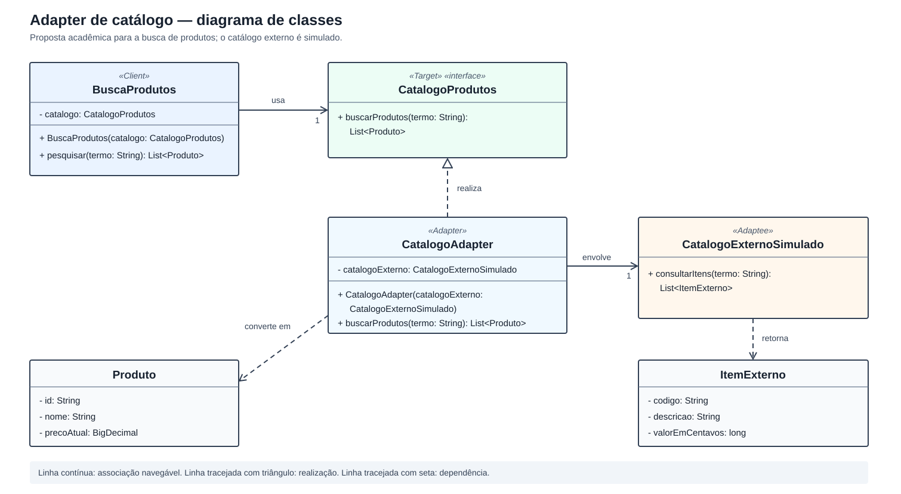

# Modelagem UML — Adapter de Catálogo

## 1. Objetivo e recorte

Este modelo detalha a [proposta de Adapter da Subequipe 02](gof_estrutural.md): uma busca de produtos usa um contrato interno, enquanto um catálogo externo **simulado** oferece outra operação e outro formato de dados. A incompatibilidade é uma hipótese didática, não uma interface observada na loja estudada. O diagrama representa a variante **Adapter de objeto**, na qual `CatalogoAdapter` recebe e envolve uma instância de `CatalogoExternoSimulado`.

O modelo retoma a busca e o conceito de `Produto` da Entrega 02. `CatalogoProdutos` é uma interface **nova e interna** deste exemplo; não corresponde à `IBuscaProdutos` exposta pelo componente **Busca e Catálogo** no diagrama de componentes anterior.

## 2. Diagrama de classes

*Figura 1 — Diagrama de classes da solução proposta. Atributos têm visibilidade privada (`−`) e operações têm visibilidade pública (`+`). O diagrama concentra as operações relevantes ao padrão; construtores e métodos de acesso dos objetos de dados foram omitidos.*

| Papel ou objeto | Elemento no modelo | Responsabilidade |
| --- | --- | --- |
| **Client** | `BuscaProdutos` | Receber `CatalogoProdutos` e chamar `buscarProdutos(termo)` por meio desse contrato. |
| **Target** | `CatalogoProdutos` | Declarar `buscarProdutos(termo: String): List<Produto>`. |
| **Adapter** | `CatalogoAdapter` | Realizar `CatalogoProdutos`, chamar o catálogo simulado e converter os itens retornados. |
| **Adaptee** | `CatalogoExternoSimulado` | Oferecer `consultarItens(termo: String): List<ItemExterno>`. |
| Objeto de entrada da conversão | `ItemExterno` | Guardar `codigo`, `descricao` e `valorEmCentavos`. |
| Objeto de saída da conversão | `Produto` | Guardar `id`, `nome` e `precoAtual` no recorte desta demonstração. |

## 3. Relações UML e fluxo da chamada

1. `BuscaProdutos` mantém uma associação navegável com **um** `CatalogoProdutos`. O cliente conhece o contrato esperado, não o tipo concreto do fornecedor.
2. `CatalogoAdapter` **realiza** a interface `CatalogoProdutos` (linha tracejada com triângulo vazio) e mantém uma associação navegável com **um** `CatalogoExternoSimulado`. A instância é recebida no construtor do adaptador.
3. Ao receber `buscarProdutos(termo)`, o adaptador repassa o mesmo termo para `consultarItens(termo)`. O catálogo simulado executa a consulta e devolve uma lista de `ItemExterno`.
4. Para cada item retornado, o adaptador cria um `Produto`: `codigo → id`, `descricao → nome` e `valorEmCentavos → precoAtual`. A lista de produtos resultante é devolvida à busca.

As setas tracejadas para `ItemExterno` e `Produto` indicam dependências de retorno e conversão. Não representam herança nem posse do ciclo de vida desses objetos. A associação entre adaptador e catálogo simulado também não declara composição: o adaptador recebe uma instância já criada.

## 4. Decisões de modelagem e critérios de coerência

| Decisão | Motivo e consequência para a implementação Java |
| --- | --- |
| `BuscaProdutos` depende de `CatalogoProdutos`. | Permite fornecer `CatalogoAdapter` sem inserir nomes e campos do fornecedor no cliente. |
| `CatalogoAdapter` guarda `CatalogoExternoSimulado`. | Demonstra o **Adapter de objeto** por composição de comportamento: a chamada é delegada à instância recebida. |
| `Produto.precoAtual` usa `BigDecimal`; `ItemExterno.valorEmCentavos` usa `long`. | O adaptador deve converter centavos com escala decimal 2, por exemplo `BigDecimal.valueOf(12990L, 2) = 129.90`, sem passar por `float` ou `double`. |
| `Produto` contém apenas três atributos. | É um recorte do `Produto` mais amplo da Entrega 02, suficiente para demonstrar a tradução sem alegar equivalência ao modelo completo. |
| A pesquisa fica restrita ao catálogo simulado. | Estoque, carrinho, checkout e pagamento não são modelados neste exemplo do padrão. |

**Cenário que deve ser preservado no código e na demonstração:** ao pesquisar um termo que encontra o item `codigo = "BOLA-01"`, `descricao = "Bola de futebol"`, `valorEmCentavos = 12990`, a busca recebe `Produto` com `id = "BOLA-01"`, `nome = "Bola de futebol"` e `precoAtual = 129.90` (`BigDecimal`, exibível como **R$ 129,90**). Uma pesquisa sem correspondência deve produzir uma lista vazia. O catálogo simulado é responsável por selecionar os itens; o adaptador é responsável pela tradução da interface e dos dados.

## 5. Rastreabilidade e limites

O recorte funcional vem do [fluxo de busca da Entrega 01](https://github.com/UnBArqDsw2026-2-Turma02/2026.2-T02-_G1_ProjetoComercioEletronico_Entrega_01/blob/main/docs/Base/subequipe2/foco2_SubEquipe_02.md). Os nomes de `Produto` e seus três atributos vêm do [modelo estático da Entrega 02](https://github.com/UnBArqDsw2026-2-Turma02/2026.2-T02-_G1_ProjetoComercioEletr-nico_Entrega02/blob/main/docs/modulo-2/subequipe-02/foco-01.md); a consulta conceitual ao Catálogo vem do [modelo dinâmico da Entrega 02](https://github.com/UnBArqDsw2026-2-Turma02/2026.2-T02-_G1_ProjetoComercioEletr-nico_Entrega02/blob/main/docs/modulo-2/subequipe-02/foco-02.md). As classes `CatalogoProdutos`, `CatalogoAdapter`, `CatalogoExternoSimulado` e `ItemExterno` são propostas desta entrega para demonstrar o [padrão Adapter descrito pelos autores do GoF](https://www.informit.com/articles/article.aspx?p=1398600).

O diagrama é uma especificação para a próxima etapa. Ainda não há implementação Java ou execução comprovando o comportamento. A revisão da modelagem pelos demais integrantes e o registro de suas contribuições individuais permanecem pendentes.

## 6. Histórico de versões

| Versão | Data | Descrição | Revisão |
| --- | --- | --- | --- |
| 1.0 | 18/10/2026 | Modelagem UML do Adapter de objeto e definição do cenário verificável para a implementação, com apoio de IA. | Pendente de revisão pela subequipe. |
